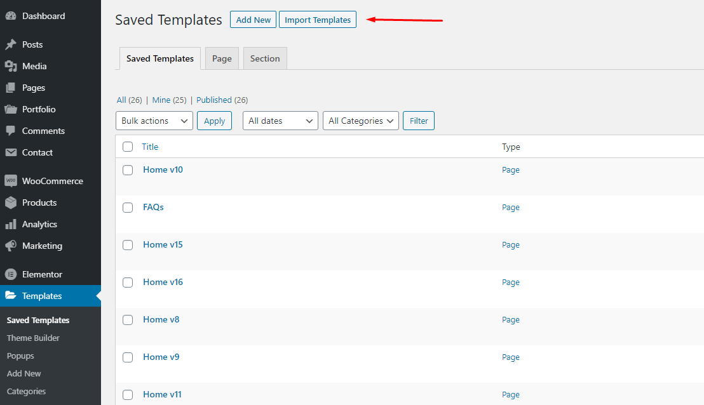

Sober has all templates for pre-defined pages that you see on the demo website. You can view all templates in the **Templates > Saved Templates** menu, after you imported Elementor demo data. However, if you don't want to import the Elementor demo data, you can import these templates separately. Please download template files here:

[Elementor Templates](https://uix.store/data/sober/elementor-templates.zip)

Sober has templates for all Homepages, About, Contact, FAQ, Stores, Coming Soon pages. You can read more about Elementor template libary and how to use it in this document:

[Elementor Template Libarary](https://elementor.com/help/template-library/)

:::note
Some homepages contains sliders. You should import demo sliders firstly, if you want to use a homepage template.
:::
