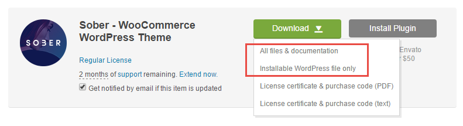
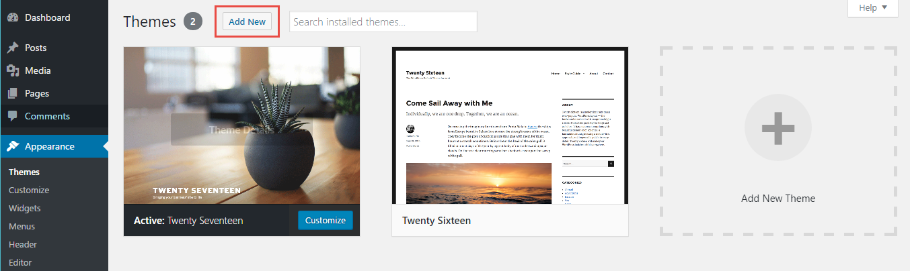
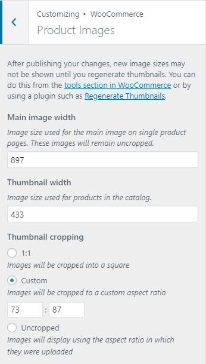
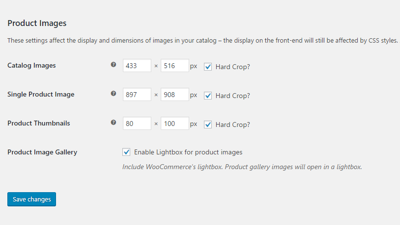
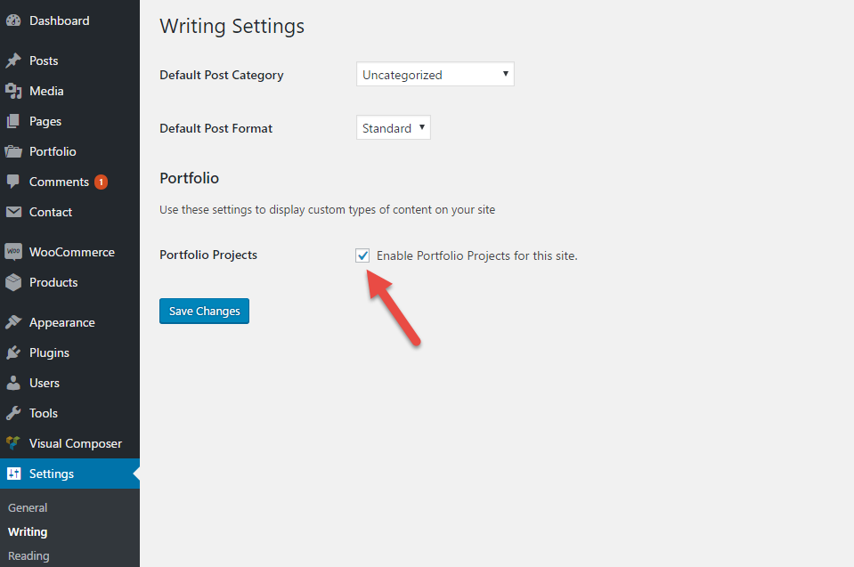

This guide covers the whole installation process in six steps, from downloading the theme files from ThemeForest to importing the demo content. Follow the steps in order, and check the [Troubleshooting](#troubleshooting) section at the end if you run into any problems.

## Step 1: Download Theme

There are two ways you can install the Sober theme. You can choose to install it via FTP, which is what will be outlined in this article, or via WordPress. Before you can install Sober, please download the necessary theme files from ThemeForest first.

If this is your first time downloading the theme from ThemeForest, we recommend downloading the Full Theme Package to receive additional files such as exported sliders, child theme, documentation. If you've already downloaded the Full Packages, then you can just use the WordPress Installable File.

**Step 1** – Login to your ThemeForest account and navigate to your _Downloads_ tab and then locate your Sober theme purchase.

**Step 2** – Click the _Download_ button and choose to either download the **Installable WordPress file only**, which is just the WordPress installable file, or choose to download **All Files & Documentation** which is the full Sober theme package.

## Step 2: Install Theme

After you download the package from ThemeForest, please unzip it. You'll see a file called `sober.zip`, which is the main file needed to upload and install.

You can either choose to upload and install the theme using **WordPress theme install** or use **FTP** function.

### Install via WordPress Dashboard

**Step 1** – Navigate to **Appearance > Themes**.

**Step 2** – Click the **Add New** button on top of the page, then the **Upload Theme** button.

**Step 3** – Click **Choose File** and find the theme files you've just downloaded. If you've downloaded the installable WordPress file, then you do not need to unzip the file. If you've downloaded the Full Theme Package, you have to unzip the master `sober.zip` file, therein you will see a secondary `sober.zip` file, this is the one you select to install.

**Step 4** - Click the **Install Now** button.

**Step 5** – When upload and installation progresses are completed, click **Activate**, or go to `Appearance > Themes` and activate the **Sober** theme.

<iframe width="560" height="315" src="https://www.youtube.com/embed/iBK5wjMua0o" frameborder="0" allow="autoplay; encrypted-media" allowfullscreen></iframe>

### Install via FTP

If you get any fail when install theme by Wordpress install function, we recommend to use FTP.

**Step 1** - If you have downloaded the Full Theme Package from ThemeForest, please unzip the package file to get the theme file `sober.zip`. Unzip the `sober.zip` file, you'll get a folder `sober`

**Step 2** - Use a FTP client like [FileZilla](http://filezilla-project.org/) and upload the extracted folder to `wp-content/themes` folder on your host

**Step 3** - Log in to your WordPress Dashboard and navigate to **Appearance > Themes** and clicking the **Activate** button of the Sober theme.

## Step 3: Install Plugins

After installing the Sober theme, you'll see a notification in the top of the page that says the theme needs some plugins to function properly.

### Required Plugins

Required plugins are very important and must be installed and activated at all times for Sober to work properly. The Sober theme **requires** following plugins

- [Woocommerce](https://wordpress.org/plugins/woocommerce/): it is a powerful, extendable eCommerce plugin that helps you sell anything.
- [Elementor](https://wordpress.org/plugins/elementor/): this is a morden page builder with rich features. You can choose to install this plugin or WPBakery Page Builder.
- [WPBakery Visual Composer](http://vc.wpbakery.com/): it is Drag and Drop Frontend and Backend Pagebuilder Plugin for Wordpress. You don't have to install both of Elementor and this plugin.
- Sober Addons: extra elements for Visual Composer. It was built for Sober theme.
- [Kirki](https://wordpress.org/plugins/kirki/): the plugin for creating theme options in the Customizer... It is free and available on WordPress.org
- [Meta Box](https://wordpress.org/plugins/meta-box/): plugin for creating meta boxes for posts, pages,... It is free and available on WordPress.org. This plugin also has premium extensions for developers who want to add more custom fields to posts, pages, custom post types. You can use this coupon to buy extensions to get 20% OFF - **[TF-MFFCW](https://metabox.io)**.

### Recommended Plugins

Recommended plugins which are plugins that we use in our demos and are fully integrated with Sober. You can choose not to install these plugins if you're not going to use them. The Sober theme **recommends** following plugins:

- [Revolution Slider](http://revolution.themepunch.com/): is an all-purpose slide displaying solution that allows for showing almost any kind of content with highly customizable, transitions, effects and custom animations. Due to its visual oriented interface and countless options, Slider Revolution is suited for beginners and pro's alike!
- [Contact Form 7](https://wordpress.org/plugins/contact-form-7/): plugin for creating contact forms. It is free and available on WordPress.org
- [MailChimp for WordPress](https://wordpress.org/plugins/mailchimp-for-wp/): helps you add more subscribers to your MailChimp lists using various methods.
- [WCBoost - Variation Swatches](https://wordpress.org/plugins/wcboost-variation-swatches/): this plugin provides a much nicer way to display variations of variable products, such as Color swatches, Size lable...
- [WooCommerce Currency Switcher](https://wordpress.org/plugins/woocommerce-currency-switcher/): is a plugin that allows your site customers/visitors switch currencies on your woocommerce store and get their rates converted in the real time.
- Soo Wishlist: plugin that is responsible for adding all Wishlist features to website. This one needs Woocommerce plugin installed to work.
- Soo Product Filter: this plugin adds a new widget for filtering products in the shop page.

Sober is working perfectly with these plugins. It automatically adds more styles to them to make the design match the theme.

### Install These Plugins

**Step 1** - From the WordPress admin, navigate to the **Appearance > Install Plugins**. Here you'll find Sober's required and recommended plugins.

**Step 2** - Just click on **Install** below each plugin's name.

**Step 3** - After installing, if it's required to activate the plugin, just activate them.

## Step 4: Config Image Sizes

After finish installing required plugins, there some options of product image sizes you must config before importing the demo content.

### With WooCommerce 3.3.0 or newer

From the version 3.3.0, WooCommerce moved settings for image sizes to **Appearance > Customize > WooCommerce > Product Images**. There are new settings for them:

- **Main image width**: 897
- **Thumbnail width**: 433
- **Thumbnail cropping**: Custom (73x87)

### With WooCommerce older than 3.3.0

In the WordPress Dashboard, navigate to **Woocommerce > Settings > Products > Display**, under the Product Images section, you will found options for image sizes of Catalog Images, Single Product Images, and Product Thumbnails.

- Catalog Images are the product thumbnails on the shop page. It is also used in shortcodes which are used to show products.
- Single Product Images are product images on the single product page.
- Product Thumbnails are small images of products. They are the product gallery thumbnails on single product page or product thumbnails on widgets.

There are settings you should use for them:

- **Catalog Images**: 433 x 516
- **Single Product Images**: 897 x 908
- **Product Thumbnails**: 80 x 100

## Step 5: Enable Portfolio Support

If you don't want to have portfolio on your site, just ignore this step and go to next step. If you want to import all portfolio demo conent, you have to enable portfolio support before process to next step. The portfolio feature is disabled by default.

From the version 1.1.0, Sober start supporting to manage and present your Portfolio. To have this feature, you have to ensure you are using at least version 1.2 of Sober Addons plugin. If you are using an older version, please [update this plugin](/sober/update/update-plugins/).

In WordPress Dashboard, navigate to **Settings > Writting** and select the option **Portfolio Project**. Remember to press the **Save Changes** button when you done.

## Step 6: Import Demo

The easiest way to import our demo content is to use our [Soo Demo Importer plugin](http://uix.store/plugins/soo-demo-importer.zip). Our importer will give you all pages and posts, several sample sliders, widgets, menus, theme options, assigned pages, and more. This is recommended to do on fresh installs. It will not replace content like posts, pages, portfolio, etc. And it will not delete current menus or sliders. It will, however, configure and use our demo menus, add sliders and replace theme options, reading settings and widgets.

### Before Importing

Before you import any of our available demos, please make sure to check the items listed below. All of these are important and will ensure that your demo import goes smoothly. In case something does go wrong with your demo import, please see the Troubleshooting section below.

- **Required Plugins**: Installed Sober's required plugins. Also make sure you've installed the recommended plugins.
- **Sober Addons**: Make sure you're using the latest version of this plugin. The "One Click Import Demo" feature was added in this plugin from **version 1.1**. Therefore please make sure you are not using an older version.
- **System Status**: Navigate to **WooCommerce > System Status** and ensure your server meets all requirements.
- **Use Modern Browsers**: To ensure the importing process runs smoothly, you should use Chrome or Firefox. They are modern browsers and support new API of Javascript. Internet Exploer is an old browser, you shouldn't use it for importing demo content.

### Import Demo Data

Once you've checked all requirements and ensure everything is ok, it's time to begin:

**Step 1** - Downnload and install the plugin [Soo Demo Importer](http://uix.store/plugins/soo-demo-importer.zip). It is a required plugin if you want to enable the "One Click Import Demo" feature.

**Step 2** - Navigate to **Appearance > Import Demo Data**, select what demo you want to import and click **Import button**.

**Step 3** - It can take a few minutes to import everything. Please be patient and wait for it to complete. During the import process, you will see the message logs to know what is going on.

<iframe width="560" height="315" src="https://www.youtube.com/embed/yb2YPmXuKHw" frameborder="0" allow="autoplay; encrypted-media" allowfullscreen></iframe>

## Troubleshooting

If something goes wrong during the installation, find your issue below.

### Theme Installation

1. **"Are you sure you want to do this?"** error

   If you get the “Are You Sure You Want To Do This” message when installing sober.zip file via WordPress, it means you have an upload file size limit that is set by your host. If this happens, please install the theme via FTP or contact your hosting company and ask them to increase the limit.

1. **Theme is missing the style.css stylesheet** error

   A common issue that can occur when installing a WordPress themes is **“The package could not be installed. The theme is missing the style.css stylesheet.”** error message being displayed when uploading or activating the theme. One of the reasons you may receive this error is if you have uploaded the incorrect file. You have 2 options for downloading your theme

   - Installable WordPress file only
   - All files and documentation (full zip folder). You will need to extract and locate the installable WordPress file.

### Plugins

1. **Failed to install/activate some plugins.**

   Sometimes, the download process failed on some hostings and some files are not downloaded. Therefore, you can't active it. Please navigate to **Plugins > Installed Plugins** and delete those plugins. Then install them again.

### Demo Import

1. **I don't see Import Demo Data menu**

   This feature requires you to install an additional plugin [Soo Demo Importer](http://uix.store/plugins/soo-demo-importer.zip). Please make sure you finished the **Import Demo Data** steps above.

1. **I stuck at the importing screen**

   Mostly, this issue comes from the hosting configuration. Please place a ticket on our [support system](http://uix.ticksy.com/). Our developer will help you check it.

1. **Where are other sliders**

   When you select to import a demo, it will import the slider of the selected demo only. If you want to have other slider, you can found all exported slider in the theme package. It locates in folder `Sober Package/Demo Data/Slider`. You can import them all to your site manually.

1. **Demo content duplicated**

   When you import our demo content, it can take several minutes depending on the speed of your server. Each time the button is clicked it will import the content, so if it is clicked twice it will import everything two times. There are two ways to get rid of duplicate content.

   **Method 1**: WP Reset Plugin – This plugin is the fastest way to get rid of content. However, it will remove all content from your database and leave the default theme activated. It does not remove plugins, but will deactivate them and remove all pages, posts, menus, sliders, widget data, theme options, etc. Basically it removes all the content that you imported from our theme. Only do this if you are able to start over. [Click Here To Download](https://wordpress.org/plugins/wordpress-reset/).

   **Method 2**: Manual Removal – This method will take longer and simply involves manually removing duplicate items. For example, go to the **Appearance > Menu** and delete and duplicate items one by one. Same thing for pages, post, sliders, etc.
