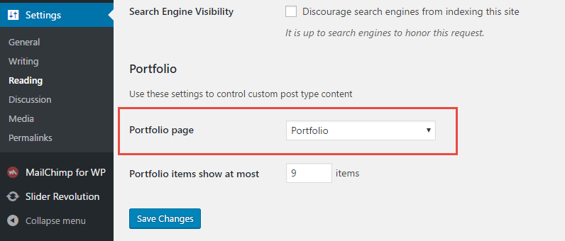

After you enable Portfolio support, you can view your portfolio in the link: `http://your_domain/portfolio`. But we recommend you to create a page for this to easier management in future. Please remember your portfolio URL will be that page's URL.

1. Go to **Pages > Add New** to create a new page for your portfolio. Name it as "Portfolio" or whatever you want.
1. Go to **Settings > Reading** to select Portfolio page.

