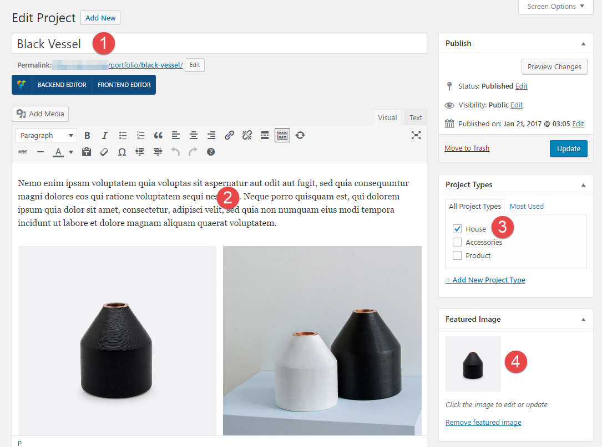
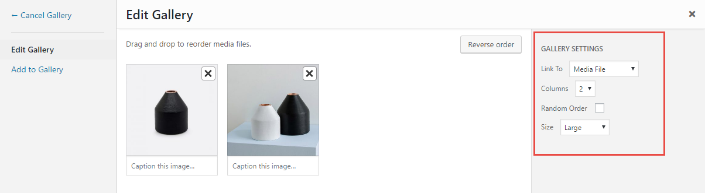

It's pretty simple to managing your projects. It's similar to managing posts. You can go to **Portfolio > All Projects** to manage your projects or go to **Portfolio > Add New** to add a new project.

In this screen, you will see it is very similar to adding/editing a page.

- **1**: enter project name here
- **2**: enter project content here. You can see we use the default WordPress's gallery to display project images. You could learn more about how to add a gallery to a post here: [The WordPress Gallery](https://codex.wordpress.org/The_WordPress_Gallery). Please note, to have a similar gallery as ours, please follow these settings:

- **3**: select project type. You can also add new project type here.
- **4**: upload the feature image for the project.
