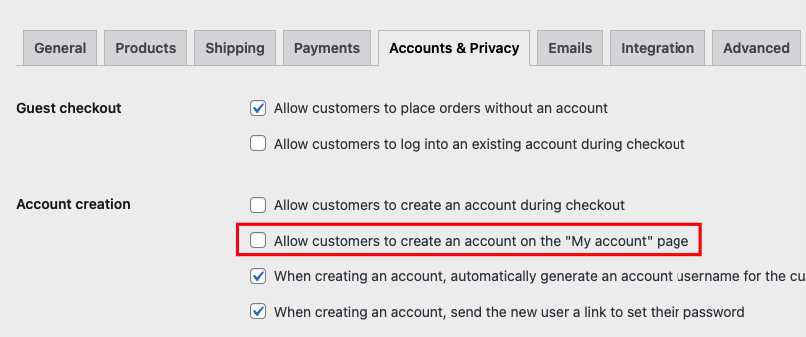

**My Account** is the page to present information of logged in user. When user is not logged in, this page will show the login form. Sober also uses the login form of this page for the login modal on header (when you click on the human icon on header, that modal will show up).

## Registration Form

By default, you will see the login form only. If you want to have the registration form, you need to enable it in **WooCommerce > Settings > Accounts & Privacy**.

