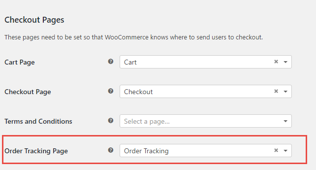

If you want to have _Order Tracking_ page, you must create it manually. But if you imported our demo content before, you can use the page we created for you.

To create _Order Tracking_ page, please go **Pages > Add New** to create a new page. You can name this page as "Order Tracking" or anything else you want. Inside that page content, please insert this shortcode: `[woocommerce_order_tracking]`

After created the _Order Tracking_ page, please go to **WooCommerce > Settings** then select **Checkout** tab. You will see an option for selecting what page is _Order Tracking_ page.

