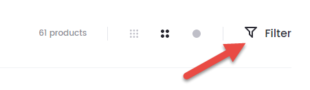

WordPress Widgets add content and features to your sidebars. In the Sober, you have following sidebars:

- **Blog Sidebar** - it is displayed on the blog, category, tag, post pages.
- **Page Sidebar** - it is displayed on pages.
- **Shop Sidebar** - it is displayed on the shop, product category, product tag pages.
- **Shop Filter** - this is a special sidebar. It is displayed on the shop, product category, product tag pages, like the shop page. But it is only show when you enable the **Filter Options** and it is a toggle-able sidebar.

Remeber to select a layout which has a sidebar in the [Layout](/sober/theme-options/layout/#blog-layout) section first if you want sidebars to be displayed.
